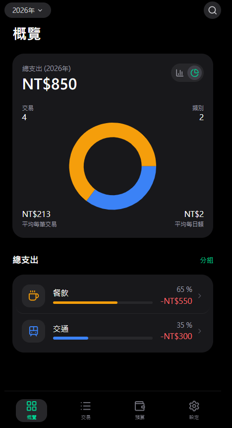
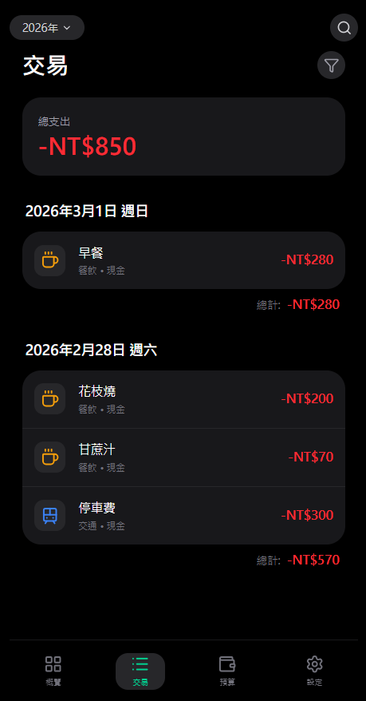
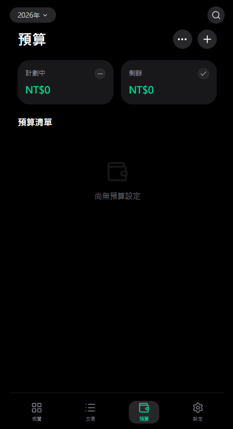

# Budget Records

> A privacy-friendly personal budgeting and expense tracking web app. Built with React 19, Vite, Tailwind CSS v4, and Supabase.

[](./LICENSE)
[](https://github.com/samsam940824/Budget-Records/actions)

**Live demo:** https://samsam940824.github.io/Budget-Records/

> ⚠️ The demo runs against a shared Supabase project. Please **sign up with a throwaway email** — do not enter real financial data on the public demo. For real usage, self-host with your own Supabase project (see below).

---

## What it is

Budget Records is a single-user, mobile-first finance tracker. Each user signs in with Supabase Auth, then records expenses and income, sets budgets per category, and views overviews by month / year / custom date range. All data is stored in your own Supabase project, protected by Row Level Security so users can only ever read or write their own rows.

This repository is intentionally small and readable — it's meant to be forkable and self-hostable, not a SaaS.

## Screenshots

| Overview | Records | Budgets |
|---|---|---|
|  |  |  |

## Features

- **Auth** — Supabase email/password sign-in.
- **Transactions** — Expenses, income and transfers between accounts, with category, account, date, optional time, location, note and currency.
- **Accounts** — Cash, bank, card and wallet accounts with opening balances, live balances, net worth, assets vs. debts, archiving and a per-account history.
- **Recurring transactions** — Daily, weekly, monthly or yearly (every N periods), with optional end date. Missed occurrences are filled in when the app opens; rules can be paused, resumed, edited or deleted.
- **Budgets** — Per-category or all-expense budgets with `none / daily / weekly / monthly / yearly` repeat and a configurable monthly reset day.
- **Configurable dashboard** — Show, hide and reorder widgets: income/expense summary, accounts & net worth, category breakdown (pie or bar, expense or income), spending trend, budget progress, upcoming recurring items and recent transactions. The layout syncs across devices.
- **Search, filter and sort** — Search all time by note, category, location or amount; filter by type, category, account and amount range; sort by date or amount.
- **Categories** — Separate expense and income categories, each with an icon or emoji and a colour, reorderable.
- **CSV import / export** — Export everything as UTF-8 CSV (opens in Excel). Import CSVs with English or Chinese headers; signed bank-style amounts are understood and missing categories/accounts are created.
- **Passcode lock** — Optional 4-digit app lock stored (hashed) on the device, with a configurable auto-lock delay.
- **Light / dark / system theme.**
- **Installable PWA** — Add to home screen, offline app shell, and a "new transaction" home-screen shortcut.
- **Optimistic UI** — Add / edit / delete reflect immediately and roll back on failure.
- **Static deploy** — Builds to a static bundle, auto-deployed to GitHub Pages from `main`.

## Tech stack

| Layer | Choice |
|---|---|
| Frontend | React 19 + TypeScript (strict), Vite 6 |
| Styling | Tailwind CSS v4 (via `@tailwindcss/vite`) |
| Charts | Recharts |
| Icons / Motion | `lucide-react`, `motion` |
| Backend / DB / Auth | Supabase (Postgres + Auth + RLS) |
| Hosting | GitHub Pages (static), GitHub Actions for CI/CD |

## Project structure

```
src/
├── App.tsx              # top-level shell, routing between features
├── main.tsx
├── features/            # UI per feature (auth, overview, records, budgets, settings)
├── hooks/               # useAuth, useTransactions, useBudgets, useOptions, useSettings
├── lib/supabaseClient.ts
├── types/database.types.ts
└── utils/
supabase/
└── migrations/0000_schema.sql   # tables + RLS policies
.github/workflows/        # GitHub Pages deploy
```

## Getting started

### Prerequisites

- Node.js 20+
- A free [Supabase](https://supabase.com) project

### 1. Clone & install

```bash
git clone https://github.com/samsam940824/Budget-Records.git
cd Budget-Records
npm install
```

### 2. Configure Supabase

1. Create a new project at https://supabase.com.
2. In the SQL editor, run [`supabase/migrations/0000_schema.sql`](./supabase/migrations/0000_schema.sql), then [`supabase/migrations/0001_accounts_recurring_dashboard.sql`](./supabase/migrations/0001_accounts_recurring_dashboard.sql). Together they create all tables and enable Row Level Security so users only see their own data.
3. In **Authentication → Providers**, enable Email (and optionally disable email confirmation while developing).
4. Copy your project URL and anon key from **Settings → API**.

### 3. Configure environment

```bash
cp .env.example .env.local
```

Then edit `.env.local`:

```env
VITE_SUPABASE_URL=https://your-project-ref.supabase.co
VITE_SUPABASE_ANON_KEY=your-anon-public-key
```

The anon key is safe to expose to the browser **as long as RLS is enabled** (the migration script does this).

### 4. Run

```bash
npm run dev      # http://localhost:3000
npm run lint     # type-check (tsc --noEmit)
npm test         # unit tests (vitest)
npm run build    # production build into dist/
npm run preview  # serve the production build locally
```

## Data model

All tables live in the `public` schema and are owned by `auth.users(id)` via `user_id`. RLS policies enforce `auth.uid() = user_id` for every read and write.

| Table | Purpose | Key columns |
|---|---|---|
| `user_settings` | Per-user prefs | `default_currency`, `budget_reset_day`, `dashboard_widgets` |
| `categories` | Expense / income categories | `name`, `type` (`expense\|income`), `icon`, `color`, `sort_order` |
| `payment_methods` | Accounts (cash / bank / cards / wallets) | `name`, `icon`, `color`, `initial_balance`, `currency_code`, `include_in_total`, `archived`, `sort_order` |
| `records` | Transactions | `type` (`expense\|income\|transfer`), `amount`, `category_id`, `date`, `time`, `description`, `currency_code`, `location`, `payment_method_id`, `to_payment_method_id`, `recurring_id` |
| `budgets` | Recurring budgets | `category_id` (null = all expenses), `amount`, `repeat` (`none\|daily\|weekly\|monthly\|yearly`), `start_date`, `end_date` |
| `recurring_transactions` | Recurring rules | `type`, `amount`, `category_id`, `payment_method_id`, `to_payment_method_id`, `frequency`, `interval_count`, `start_date`, `end_date`, `next_date`, `active` |

Full schema and RLS policies: [`supabase/migrations/`](./supabase/migrations/).

### Upgrading an existing project

If your Supabase project was created before accounts and recurring transactions existed, run [`supabase/migrations/0001_accounts_recurring_dashboard.sql`](./supabase/migrations/0001_accounts_recurring_dashboard.sql) once in the SQL editor **before** deploying this version. It only adds columns, a table and constraints; existing data is kept, existing payment methods become accounts with a zero opening balance, and existing categories become expense categories. The app shows a banner pointing to this file if it is missing.

## Deployment

The repo ships with a GitHub Actions workflow at `.github/workflows/` that builds and deploys to GitHub Pages on every push to `main`. To use it on your fork:

1. **Settings → Pages → Build and deployment → Source:** select **GitHub Actions**.
2. **Settings → Secrets and variables → Actions** → add repository secrets:
   - `VITE_SUPABASE_URL`
   - `VITE_SUPABASE_ANON_KEY`
3. If your fork's repo name is not `Budget-Records`, update the `base` in `vite.config.ts` to match (e.g. `/your-fork-name/`).

## Roadmap

Tracked as open issues — see [Issues](https://github.com/samsam940824/Budget-Records/issues). Headline items:

- [x] Export transactions to CSV (and import)
- [x] PWA install and offline app shell (data still needs a connection)
- [ ] Multi-currency support with FX rates
- [ ] Budget threshold notifications
- [ ] Documented Supabase RLS hardening guide
- [ ] Component test coverage (core logic has unit tests)

## Contributing

Issues, bug reports, and pull requests are welcome. Please read [CONTRIBUTING.md](./CONTRIBUTING.md) before opening a PR. For security issues, see [SECURITY.md](./SECURITY.md) — please do not file public issues for vulnerabilities.

## License

[MIT](./LICENSE) © 2026 samsam940824
